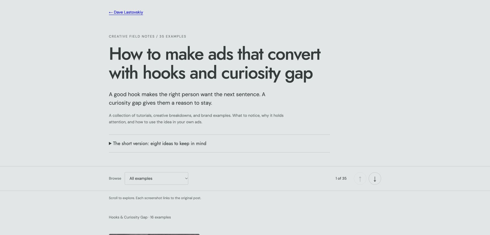
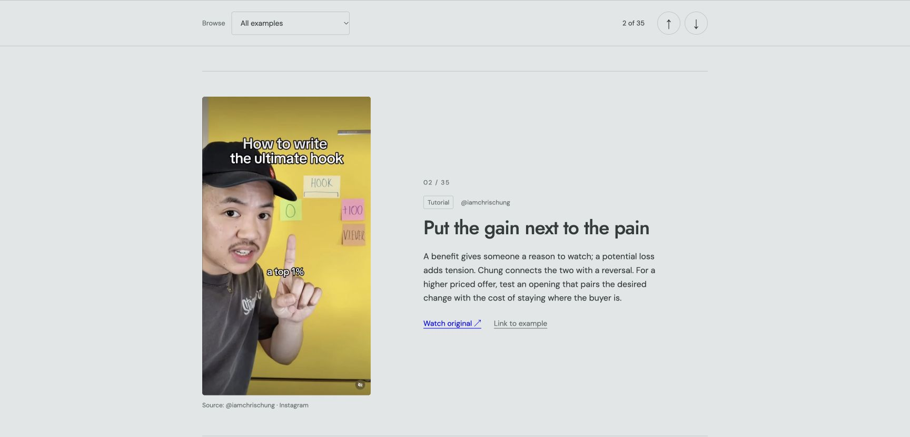
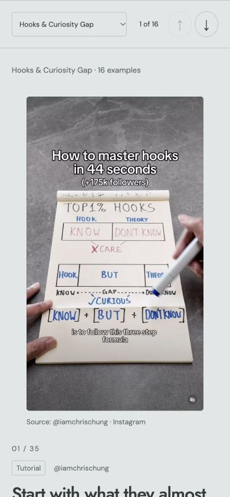
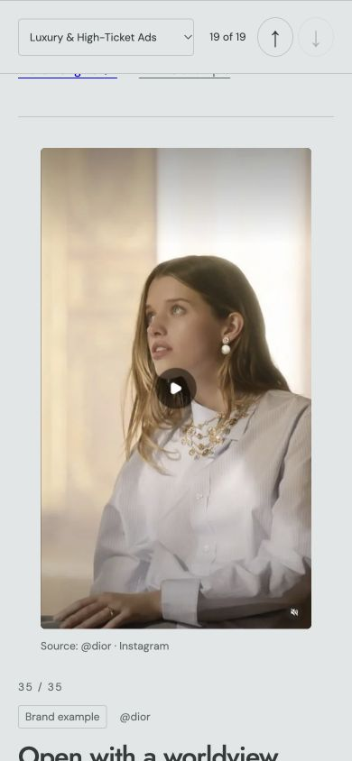
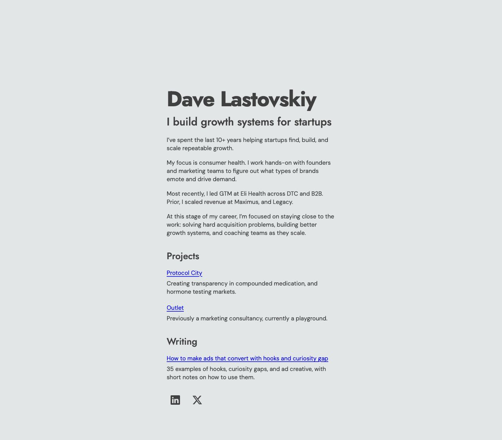

# Review: hooks and curiosity gap guide

## Verified locally

- Source reconciliation: all 35 workbook rows appear once, in order, with matching creator, source tab/row, and original hyperlink. All 35 screenshots were captured and visually inspected in a contact sheet.
- All descriptions contain 35–60 words. All anchors are unique; local CSS, JavaScript, and image references resolve. Generated HTML includes all content without needing JavaScript.
- Desktop: screenshot and text columns, category selection (35 / 16 / 19 examples), first-item previous boundary, next/previous navigation, and keyboard Enter on the next button.
- Mobile: checked 390 × 844 and 320 × 740. No horizontal overflow; screenshots appear above the explanation. Native scrolling updates the counter. A final-example deep link survives reload with the correct count and disabled next button.
- Homepage: Writing follows Projects; the exact requested link opens the new guide. Existing content and analytics remain in place.
- Motion handling: navigation jumps immediately without animation; CSS also honors reduced motion. The device preference itself was not changed during QA.
- `python3 tools/build-ad-playbook.py` and `git diff --check` pass.

## Screenshots

Deployment verification is pending merge. This change does not merge itself or change the publishing configuration.
